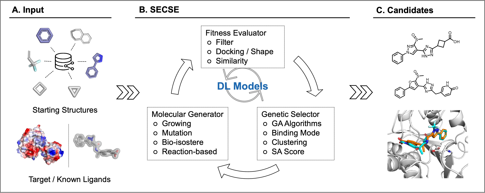

# SECSE

### SECSE: _**S**ystemic **E**volutionary **C**hemical **S**pace **E**xplorer_

SECSE grows small molecules from seed fragments in a protein pocket. In each generation, it applies growth rules,
filters the new molecules and uses docking scores to select seeds for the next round. You can use Chemprop to
predict scores and decide which additional candidates to dock.



### Installation and first run

Use Linux with [Conda](https://github.com/conda-forge/miniforge) installed. For a CPU-only machine, choose Vina.

#### Step 1. Download SECSE

```bash
git clone https://github.com/KeenThera/SECSE.git
cd SECSE
```

Run the following commands from this directory.

#### Step 2. Install a docking program

Choose **one** option. Each command creates the `secse` environment and installs the shared dependencies.

- **Vina (CPU)**

  ```bash
  ./setup.sh vina
  ```

- **Uni-Dock (NVIDIA GPU)**

  Installs Uni-Dock 1.2.0 in a separate engine environment. A compatible NVIDIA driver is required.

  ```bash
  ./setup.sh unidock
  ```

- **AutoDock GPU**

  Install [AutoDock GPU](https://github.com/ccsb-scripps/AutoDock-GPU/releases) first.
  Replace the path below with its installation directory, which contains `bin/autodock_gpu_128wi`.

  ```bash
  ./setup.sh autodock-gpu --install-dir /path/to/autodock-gpu
  ```

- **Glide**

  Use an existing licensed [Schrödinger installation](https://www.schrodinger.com/products/glide).
  Replace the path below with its installation directory.

  ```bash
  ./setup.sh glide --install-dir /path/to/schrodinger
  ```

Already have a SECSE environment? Use [Add another docking program](#add-another-docking-program-optional).
To create an environment with a different name, append `--env NAME` to the setup command.

#### Step 3. Activate and check the environment

```bash
conda activate secse
python -m secse doctor
```

If you chose a different environment name, replace `secse` with that name.

#### Step 4. Run the PHGDH example

Run the command for your docking program. Vina and Uni-Dock use the bundled receptor.
For AutoDock GPU and Glide, prepare a PHGDH grid and replace the example path.

- **Vina**

  ```bash
  python -m secse demo phgdh --backend vina
  ```

- **Uni-Dock**

  ```bash
  python -m secse demo phgdh --backend unidock
  ```

- **AutoDock GPU** (`.maps.fld` and its accompanying maps)

  ```bash
  python -m secse demo phgdh --backend autodock-gpu --target /path/to/phgdh.maps.fld
  ```

- **Glide** (grid `.zip`)

  ```bash
  python -m secse demo phgdh --backend glide --target /path/to/phgdh-grid.zip
  ```

The command prints the result directory. Open `selected.sdf` for docked structures, the CSV for scores,
and `secse.ini` for the settings used.

<details>
<summary>PHGDH grid settings for AutoDock GPU and Glide</summary>

The tests used a grid center of `20.9, -10.4, 3.0`. AutoDock GPU used an AutoGrid grid of
`40 × 40 × 40` points at `0.375 Å` spacing. Glide used PDB 6RJ3 chain A prepared with Protein Preparation Wizard,
with an OPLS3e grid and inner and outer boxes of `10 Å` and `20 Å`.

</details>

### Run your own inputs

Prepare an SMI file with one molecule per line: SMILES, a tab, then the molecule ID. Omit the header.

For Vina, replace the input filenames and box center below with your own values:

```bash
python -m secse run --backend vina --fragments seeds.smi --target receptor.pdbqt \
  --center 20.9 -10.4 3.0 --workdir results
```

Use an empty output directory. This runs one growth generation; add `--generations 0` to dock only the input
fragments. Uni-Dock uses the same options with `--backend unidock`. AutoDock GPU and Glide use their prepared
grid as `--target`; omit `--center`.

To use an existing INI, replace the path below:

```bash
python -m secse run --config /path/to/secse.ini
```

SECSE reads the docking program from the INI. To resume, set `start_gen` to the last completed generation
and keep the previous `workdir`. The original `python secse/run_secse.py --config /path/to/secse.ini`
command also works with the engine's environment variables.

### Add another docking program (optional)

With your SECSE environment active, run the commands for the program you want to add.

- **Uni-Dock in a separate Conda environment**

  ```bash
  conda create -n secse-unidock --override-channels -c conda-forge unidock=1.2.0
  python -m secse backend add unidock --conda-env secse-unidock
  ```

- **An existing [Vina](https://github.com/ccsb-scripps/AutoDock-Vina/releases) executable**

  ```bash
  python -m secse backend add vina --executable /path/to/vina
  ```

- **An existing [Uni-Dock](https://github.com/dptech-corp/Uni-Dock/releases) executable**

  ```bash
  python -m secse backend add unidock --executable /path/to/unidock
  ```

  If it needs a separate shared-library directory, append `--library-dir /path/to/lib`.

- **An existing AutoDock GPU installation**

  ```bash
  python -m secse backend add autodock-gpu --install-dir /path/to/autodock-gpu
  ```

- **An existing Glide installation**

  ```bash
  python -m secse backend add glide --install-dir /path/to/schrodinger
  ```

Check the registered programs:

```bash
python -m secse backend list
python -m secse doctor --all
```

Adding a program keeps your current default. For example, use Uni-Dock for one run:

```bash
python -m secse demo phgdh --backend unidock
```

Or make it the default for commands without `--backend`:

```bash
python -m secse backend default unidock
```

Settings are saved in `~/.config/secse/backends.json`, or `$XDG_CONFIG_HOME/secse/backends.json` when set.

### Score prediction (optional)

Install Chemprop in the active SECSE environment:

```bash
python -m pip install 'chemprop~=2.1.0'
python -m secse doctor --prediction
```

Then set `mode = 1` or `mode = 2` in the INI's `[prediction]` section.

### Advanced INI settings

Start with the [example INI](demo/phgdh_demo_vina.ini). It runs five growth generations with four CPUs and
prediction disabled. Its relative paths assume you run SECSE from the repository root. Relative paths in an
INI are resolved from the working directory where you launch SECSE. In shell commands, quote paths containing spaces.
Use the [example rule file](demo/rules.json) if you want to supply your own growth rules.

#### `[general]`

- `project_code` is the prefix for generated molecule IDs.
- `workdir` is where SECSE writes results. Use a fresh directory for a new project and the previous directory when resuming.
- `fragments` is the path to the input SMI file.
- `num_per_gen` sets the target number of molecules to dock per growth generation.
- `seed_per_gen` sets the number of seeds selected by tournament ranking. The default is 1,000.
- `start_gen` is the last completed generation when resuming. Use `0` for a new run.
- `num_gen` is the number of additional growth generations. Use `0` to dock the input fragments only on a new run.
- `cpu` controls CPU parallelism. `gpu` controls GPU concurrency for AutoDock GPU.
- `rule_db` accepts a rules JSON or SQLite database. Use `0` for the bundled rules. Custom JSON rule IDs use the form `G-001-0001`.

#### `[docking]`

- `docking_program` selects `vina` (the default), `unidock`, `autodock-gpu` or `glide`.
- `target` is the receptor PDBQT for Vina or Uni-Dock, the AutoGrid `.maps.fld` for AutoDock GPU, or the grid `.zip` for Glide.
- `x`, `y` and `z` give the box center for Vina and Uni-Dock. `box_size_x`, `box_size_y` and `box_size_z`
  give the side lengths in ångströms and default to 20.
- `rmsd` and `delta_score` set the thresholds for comparing each new molecule's pose and docking score with its parent's.
  `score_cutoff` sets the docking score threshold.

#### `[prediction]`

- `mode` defaults to `0` (off). Use `1` to train and predict each generation or `2` to train and predict at the end.
  SECSE skips prediction if fewer than eight scored molecules are available for training.
- `dl_per_gen` is the number of top predictions sent to docking.
- `dl_score_cutoff` is the score cutoff for predicted molecules in the final report in mode `2`.

#### `[properties]`

- _mw_ sets the molecular weight cutoff (integer, default 450).
- _logp_lower_ and _logp_upper_ set the logP range (floats, defaults 0.5 and 7).
- _chiral_center_ caps the number of chiral centers (integer, default 2).
- _heteroatom_ratio_ caps the fraction of heteroatoms (float, default 0.35).
- _rdkit_rotatable_bound_num_ caps the number of rotatable bonds counted by
  rdkit.rdMolDescriptors.CalcNumRotatableBonds (integer, default 5).
- _keen_rotatable_bound_num_ caps the number of rotatable bonds under the KEEN definition (integer, default 3).
  SMARTS: `[C^3!D1;!$(C(F)(F)F)]-!@[!Br!F!Cl!I!H3&!$(*#*)!D1;!$([!Br!F!Cl!I](F)(F)F)]`
- _rigid_body_num_ caps the number of rigid bodies under the KEEN definition (integer, default 2).
  SMARTS: `[C^3!D1;!$(C(F)(F)F);!R;!$(C=O(N));!$(NC(=O));!$(C(=O)O);!$(C(=O)O)]-!@[!Br!F!Cl!I!H3&!$(*#*)!D1;!$([!Br!F!Cl!I](F)(F)F);!R;!$(C=O([N,O]));!$(NC(=O));!$(C(=O)O)]`
- _hbd_ caps the number of hydrogen bond donors counted by rdkit.rdMolDescriptors.CalcNumHBD (integer, default 5).
- _hba_ caps the number of hydrogen bond acceptors counted by rdkit.rdMolDescriptors.CalcNumHBA (integer, default 10).
- _tpsa_ caps the topological polar surface area calculated by rdkit.Chem.Descriptors.TPSA (float, default 200).
- _lipinski_violation_ caps the number of Lipinski rule of five violations counted by RDKit (integer, default 1).
- _qed_ sets the QED cutoff calculated by rdkit.Chem.QED.qed (float, default 0.5).
- _max_ring_size_ caps the size of a ring (integer, default 7).
- _max_ring_system_size_ caps the number of rings in a single ring system (integer, default 3).
- _ring_system_count_ caps the number of separate ring systems (integer, default 4).
- _bridged_site_count_, _spiro_site_count_ and _fused_site_count_ cap the corresponding ring junction counts
  (integers, defaults 2, 1 and 3).
- _rdkit_sa_score_ sets the RDKit synthetic accessibility score cutoff (float, default 5).
- _substructure_filter_ takes the path to an "*.xls" file of SMARTS for unwanted substructures. Include the
  columns `Pattern`, `ID` and `Max`, with a unique `ID` for each SMARTS. Use 0 (the default) to skip custom
  filters. The built-in PAINS filter still applies. See the [example spreadsheet](demo/subtructure_filter_demo.xls).

Successful runs and normal early stops return status `0`. Invalid command-line arguments return `2`.
Configuration and runtime failures return `1`.

### Dependencies

The setup script creates a Python 3.12 Conda environment and checks its dependencies after installation.
It installs Open Babel through Conda. The pip requirements use `openbabel-wheel`, which provides the Python
bindings and the `obabel` command in a virtual environment.

For a pip installation, use Python 3.12 and run these commands from the repository root:

```bash
python3.12 -m venv .venv
source .venv/bin/activate
python -m pip install -r requirements.txt
python -m pip check
```

The [requirements file](requirements.txt) installs Python dependencies. Install GNU Parallel, Perl and your
chosen docking engine separately. Register the engine as described [above](#add-another-docking-program-optional),
then run `python -m secse doctor`. Run SECSE from the repository root with this environment active.

Install GNU Parallel and Perl using the command for your distribution, or build GNU Parallel from source.

- CentOS / RHEL  
  `sudo yum install parallel perl`
- Ubuntu / Debian  
  `sudo apt-get install parallel perl`
- From source: https://www.gnu.org/software/parallel/

Vina can run on a CPU-only server with prediction disabled. Chemprop 2.1 requires Python 3.11 or newer.
AutoDock GPU and Uni-Dock need a compatible GPU, and Glide needs a Schrödinger license.

Run the regression suite with `python -m unittest discover -s tests -v`. The tests use substitute docking programs
to check how SECSE calls each engine and handles its output. The PHGDH runs used the installed engines.

### What's new

- Added native Conda setup, a PHGDH demo and commands to register docking engines and select a default.
  Uni-Dock can run from a separate Conda environment.
- Added command-line input options and saved INI settings for each run. Existing INI files and the original
  `--config` command still work. Chemprop 2.1 is an optional dependency.
- To resume, set `start_gen` to the last completed generation. SECSE loads the saved results and seeds for that
  generation and continues from the next one. It writes a report even if screening stops after generation 0.
  Configuration and tool failures return a nonzero exit code so batch jobs can detect them.
- Candidate clustering used less peak memory in the benchmark and assigned the same molecules to the same clusters.
  The PHGDH tests covered all four docking engines. The [clustering benchmark](tests/benchmark_clustering.py)
  compares assignments using fixed inputs.

### Citation

Lu, C.; Liu, S.; Shi, W.; Yu, J.; Zhou, Z.; Zhang, X.; Lu, X.; Cai, F.; Xia, N.; Wang, Y. Systemic Evolutionary Chemical
Space Exploration For Drug Discovery. J Cheminform 14, 19 (2022).

https://doi.org/10.1186/s13321-022-00598-4

### License

SECSE is released under [Apache License, Version 2.0](LICENSE.txt).

SECSE is in active development. For questions or suggestions, please contact:
wang_yikai@keenthera.com or luchong121@outlook.com
